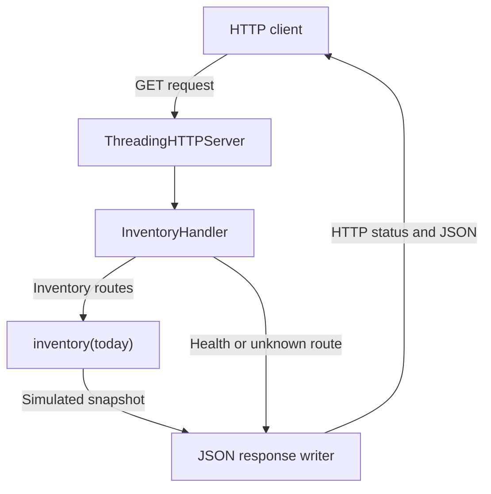

# System Architecture

## Architectural Style

The Lab 8 prototype is a client–server application with one Python HTTP service. Within that process, the request handler routes HTTP requests, the inventory function classifies stock and expiry dates, and the response writer serializes results. This design keeps the prototype easy to run and package using the Python standard library.

## Component Interaction Diagram

## Data Flow and Execution Lifecycle

1. Running `python app.py` starts the threaded server on port 8080. A client sends an HTTP GET request.
2. For `/` and `/inventory`, the handler passes the current date to `inventory(today)`. The function generates four simulated entries, flags quantities of two or fewer as low stock, and classifies expiry as expired, expiring soon, or fresh.
3. The handler returns the snapshot as JSON with HTTP 200. The `/health` path returns a status object with HTTP 200. Unknown GET paths return an error object with HTTP 404.
4. The service generates the snapshot for each request. The lab prototype has no persistence or external API calls. Physical sensors, cloud synchronization, and the dashboard are planned project scope.

## Architecture Decision Records

- **ADR-01 — Single standard-library HTTP service.** The team needed a small runnable prototype for the Git and Docker workflow. A single process keeps startup, deployment, and dependency management simple. Authentication and richer routing would require additional implementation.
- **ADR-02 — In-memory simulated inventory.** Physical inputs were outside the prototype scope. Fixed sample data made it possible to verify low-stock and expiry behavior locally and in Docker. The prototype serves read-only snapshots, and inventory state does not persist across runs.
