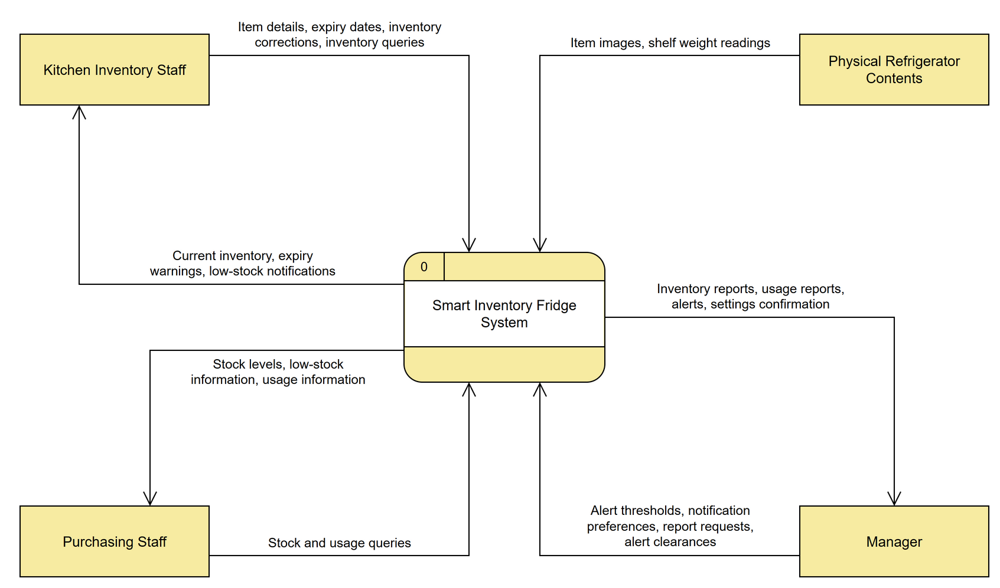
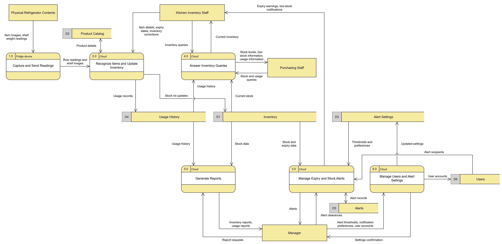
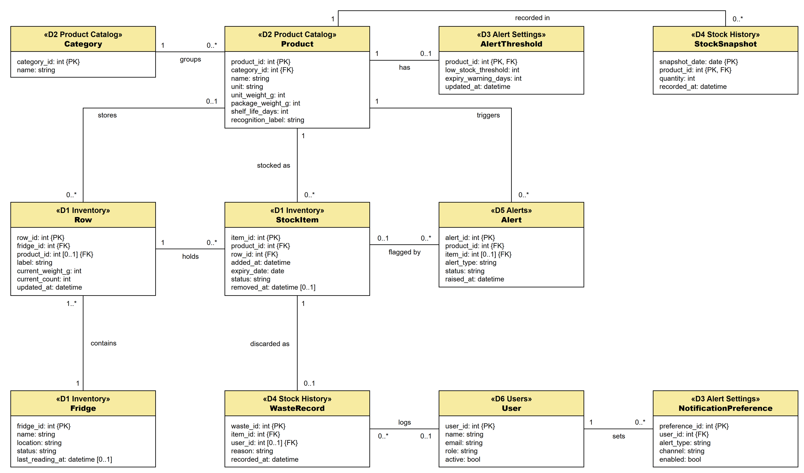

# Diagrams

Data flow diagrams use Gane–Sarson notation and are drawn in [draw.io](https://www.drawio.com/).

Each diagram is defined in a JSON file, which is the source of truth. That file lists every entity, process, data store and data flow, along with the layout (box positions and arrow routes). [build_drawio.py](build_drawio.py) generates an editable `.drawio` file from each JSON file, and draw.io exports the PNG.

| Diagram | Source | Editable | Image |
|---|---|---|---|
| Context | [context-dfd.json](context-dfd.json) | [context-dfd.drawio](context-dfd.drawio) | [context-dfd.png](context-dfd.png) |
| Level-0 (draft) | [level0-dfd.json](level0-dfd.json) | [level0-dfd.drawio](level0-dfd.drawio) | [level0-dfd.png](level0-dfd.png) |

## Regenerate

Run these from this folder after changing any JSON file:

```sh
python build_drawio.py
"C:/Program Files/draw.io/draw.io.exe" -x -f png -s 2 -b 16 -o context-dfd.png context-dfd.drawio
"C:/Program Files/draw.io/draw.io.exe" -x -f png -s 2 -b 16 -o level0-dfd.png level0-dfd.drawio
```

The script uses only the Python standard library. If you move things by hand in draw.io, copy the new positions back into the JSON's `layout` section. Otherwise the next regeneration overwrites your changes.

## Context diagram



Version 2.0 adds one change from Deliverable 1: the **Physical Refrigerator Contents** external entity (E4) and its data flow F7, "Item images, shelf weight readings". The cameras and sensors are inside the system boundary, so the items they observe must be shown as an external source. Without it, on-device capture has no input.

## Level-0 diagram



The Level-0 diagram takes its external entities from the context diagram. Each external flow names its parent context flow; for example, F1a and F1b together make up F1. On every build, the script checks that every context flow appears here with the same external entity, and that every data element is carried exactly once. If any of this is wrong, the build fails.

The header band of each process shows where it runs: **Fridge device** (simulated edge hardware) or **Cloud**.

## Entity relationship diagram (draft)



The ERD uses UML class notation. [erd.json](erd.json) defines each entity's attributes, with keys, types, nullability and a description of each, plus the relationships and multiplicities. Each class header shows, as a «stereotype», which Level-0 data store the entity belongs to.

```sh
python build_erd.py
"C:/Program Files/draw.io/draw.io.exe" -x -f png -s 2 -b 16 -o erd.png erd.drawio
python build_data_dictionary.py
```

The last command generates the [data dictionary](../data-dictionary.md) from the same JSON file. It also checks that every foreign key points to an existing attribute.
